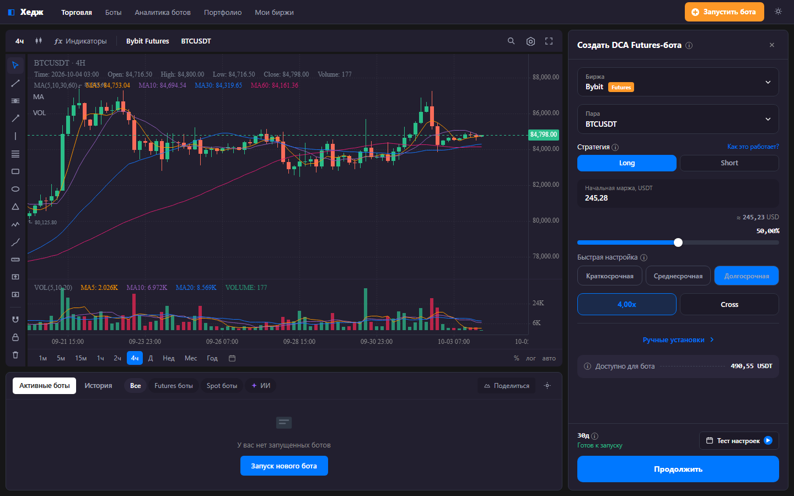

# Hedge Terminal

A **personal, single-user** crypto trading terminal for **Bybit USDT-perpetuals**,
built to configure and run my own DCA / mean-reversion strategies.

> Personal project. Not a commercial product. Single user. No public sign-up,
> no resale, no redistribution.

## Screenshot

## What it does

- **Real-time candlestick chart** — Bybit v5 public REST + WebSocket, custom Datafeed.
- **Chart engine** — KLineChart: 6 chart types, 40+ indicators, 30+ drawing tools,
  10 timeframes, drawing legend (show/hide/settings/delete), indicator legend.
- **DCA bot drawer** — exchange, searchable pair picker (all USDT futures of the
  selected exchange), strategy, initial margin, leverage, TP/SL, risk management.
- **Watchlist drawer** — full list of USDT futures of the selected exchange
  (Bybit / Binance / OKX / Bitget) with price, 24h change and turnover.
- **Light / dark theme.**

## Stack

| Layer | Tech |
|---|---|
| Frontend | React 18 + TypeScript + Vite |
| Chart | KLineChart 10 (+ react-klinecharts-ui) |
| Data | Bybit v5 public REST + WebSocket (own Datafeed) |
| Watchlist sources | Bybit, Binance, OKX, Bitget (public APIs) |

## Status

Personal use, work in progress. Not deployed publicly.

## Note on TradingView

I'm applying for **Advanced Charts** to use it as the charting front-end with my own
Datafeed. The required TradingView attribution/logo will be kept visible.
